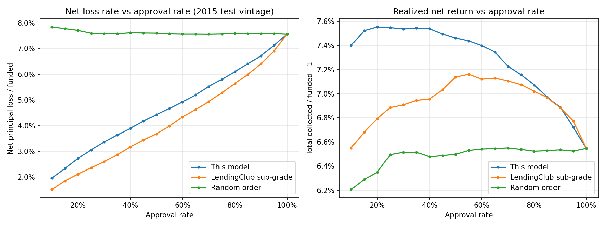

# Consumer lending credit risk: LendingClub 2007–2018

Cohort analysis, a default-risk model, approval-rate/loss tradeoffs and a fair-lending review, built on 2.26 million public LendingClub loans using SQL and Python.

**Read first:** [FINDINGS.md](FINDINGS.md), a one-page write-up of the results.
**How the AI-assisted code was checked:** [VERIFICATION.md](VERIFICATION.md).



## Questions answered
1. **How do delinquency and default vary by cohort?** By vintage, grade, months on book, FICO and DTI ([sql/](sql/)).
2. **Can a simple, explainable model predict default?** A logistic regression on application-time data only, with an out-of-time test, benchmarked against LendingClub's own grades ([src/model.py](src/model.py)).
3. **What does a lender give up by approving more people?** Default rate, net loss and realized return at each approval rate ([outputs/approval_tradeoff.csv](outputs/approval_tradeoff.csv)).
4. **What are the fair lending risks?** Proxy variables, a geographic screen, adverse-action reason codes and selection bias ([src/fair_lending.py](src/fair_lending.py)).

## Headline results
| | |
|---|---|
| Lifetime default, 36-month loans | 10.6% (2011 vintage) → 14.9% (2015 vintage) |
| Default by grade, 2015 | A 5.4% → G 45.6% |
| Model AUC (out-of-time, 2015) | 0.661 (LendingClub sub-grade: 0.679) |
| Approving the safest 80% instead of all | Losses 7.6% → 6.1% of principal; return 6.6% → 7.1% |
| Verification checks | 16 of 16 passing |

## Data
LendingClub's accepted-loans file (2007–2018Q4, 151 columns, 1.7 GB). It was originally published by LendingClub and is mirrored on [Kaggle](https://www.kaggle.com/datasets/wordsforthewise/lending-club) and [Hugging Face](https://huggingface.co/datasets/codesignal/lending-club-loan-accepted). Performance is as of March 2019. The raw data is not committed to this repo.

## Project layout
```
sql/                           cohort queries (SQLite)
  01_status_mix_by_vintage.sql   delinquency snapshot by issue year
  02_default_by_vintage_grade.sql  default and net loss rate by vintage x grade
  03_vintage_curves.sql          cumulative default by months on book
  04_default_by_risk_factor.sql  default by FICO and DTI band
src/
  load_data.py      raw CSV -> cleaned SQLite table (data/lending.db)
  run_cohorts.py    runs the SQL, saves tables and charts
  model.py          logistic regression, calibration, approval tradeoff
  fair_lending.py   adverse-action reasons, geographic approval screen
  verify.py         16 independent checks on the outputs
outputs/            result tables (.csv), metrics, figures/
FINDINGS.md         one-page write-up
VERIFICATION.md     how the AI-generated code was checked
```

## Reproduce
```bash
python3 -m venv .venv && .venv/bin/pip install -r requirements.txt
mkdir -p data/raw && curl -L -o data/raw/accepted_2007_to_2018Q4.csv \
  https://huggingface.co/datasets/codesignal/lending-club-loan-accepted/resolve/main/accepted_2007_to_2018Q4.csv
./run_all.sh
```
After the download, a full run takes about a minute on a laptop. If the download stalls, add `-4 -C -` to the curl command to force IPv4 and resume.

## Method notes
- **Model sample:** 36-month individual loans issued 2012–2015 that have been resolved (99.95% of that cohort). Train on 2012–2014, test on 2015.
- **Excluded from the model:**
  - LendingClub's grade, sub-grade, interest rate and instalment (its own risk pricing; used as a benchmark instead)
  - ZIP code and state (proxy risk)
  - all post-origination fields (leakage)
- **Default** means a status of Charged Off or Default. **Net loss** is funded amount minus principal repaid minus net recoveries. **Realized return** is total cash collected divided by funded amount, minus 1. It is not annualized and is before servicing fees.

## Built with Claude Code
The SQL, Python and documents were written with Claude Code and then checked: by independent recomputation, invariant tests, a second-library refit, and a manual review of every chart and number. VERIFICATION.md lists the six issues that review caught and how each was fixed.
